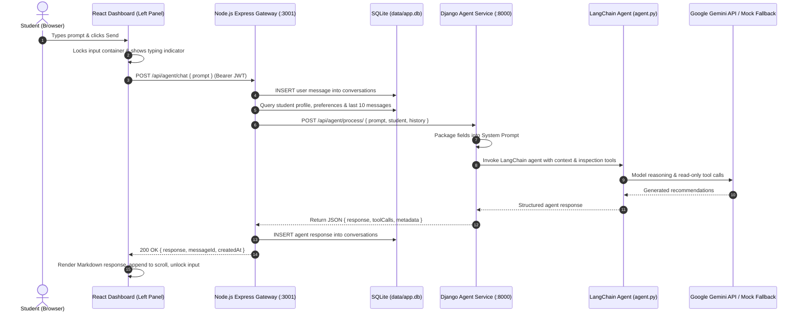

# Agent Setup Specification & Implementation Design

**User Story:**  
> *As a user, I want an interactive agent so that my decisions influence the final produced calendar.*

Currently, the left panel of the dashboard is a placeholder (`client/src/components/dashboard/AgentPlaceholder.tsx`). This specification document resolves the user story above by formalizing the decisions agreed upon during the architecture interview and defining the end-to-end design across frontend, Node.js gateway, Django agent service, database persistence, and automated testing.

---

## 1. System Architecture & Component Flow

The system employs a 3-tier architecture: **React 18 Class Component Frontend** &rarr; **Node.js / Express API Gateway & Database Owner** &rarr; **Django / Python LangChain Agent Service**.



### Key Architectural Boundaries
1. **Node.js is the Primary Gateway & Single Database Owner**:
   - Manages all user authentication, session tokens, and SQLite database connections (`data/app.db`).
   - Persists all conversation messages (`USER` and `AGENT`) in SQLite to prevent concurrent write contention between Node and Python.
   - Forwards sanitized queries along with contextual data to Django via an internal REST API (`http://127.0.0.1:8000/api/agent/process/`).
2. **Django as a Dedicated Agent Microservice**:
   - Resides in a dedicated top-level directory `agent_service/`.
   - Runs stateless execution of `agent.py`.
   - Packages student data, preferences, and sliding history into the system prompt.
   - Communicates with Google Gemini via LangChain with automated offline dev mock fallback.

---

## 2. Conversation Flow for a Single Query

For every incoming query:
1. **Client Submission**:
   - The user inputs text into the chat container and presses Enter or clicks Send.
   - The input container immediately locks (input field and submit button disabled) and displays an active typing indicator to block concurrent prompts while processing.
2. **Node Packaging & Persistence**:
   - Node validates the request (`prompt` is non-empty, string length between 1 and 2,000 characters).
   - Node inserts the user's message into SQLite `conversations`.
   - Node gathers the student's profile (name, standing, major, minor), onboarding answers (GEs completed, major requirements taken, target credits, break preferences), current calendar preview courses, and the sliding window of the last 10 chat messages.
3. **Django System Prompt Formulation**:
   - Django receives the payload from Node and constructs the formatted system prompt:
     - Sets persona: *Sammy the Slug Scheduling Advisor*.
     - Injects academic constraints: student's standing, completed requirements, remaining GEs, and weekly time commitments.
     - Formats historical turns in standard human/assistant format.
4. **LangChain Agent Execution**:
   - `agent.py` acts as the execution entrypoint.
   - The agent is equipped with read-only inspection tools to query specific requirements and verify schedule states.
   - If `GEMINI_API_KEY` is present, it invokes `gemini-1.5-flash` via `langchain-google-genai`. If absent, an internal deterministic mock agent responds with tailored UCSC course advice.
5. **Response Delivery**:
   - The response is returned to Django, which sends a structured JSON payload back to Node.
   - Node persists the `AGENT` message in SQLite.
   - Node returns the response to the frontend client, which renders formatted Markdown and unlocks the input container.

---

## 3. Agent Tool Definitions (Read-Only Inspection Tools)

In this sprint, mutations to the calendar are suggested conversationally rather than committed directly. The agent in `agent.py` is equipped with three read-only inspection tools:

| Tool Name | Parameters | Purpose | Output |
| :--- | :--- | :--- | :--- |
| `inspect_student_profile` | `user_id: str` | Inspect student major, minor, standing, and credit preferences | JSON object with degree status and target credits |
| `query_degree_ge_requirements` | `major: str, standing: str` | Query remaining GE categories (CC, ER, IM, etc.) and required major courses | List of unmet general education and major requirements |
| `inspect_calendar_schedule` | `user_id: str, term: str` | Inspect the student's current weekly course schedule and Google Calendar busy blocks | Array of scheduled meeting times, days, and event types |

> [!NOTE]
> *Future Tool Offloading*: Future sprints will integrate Google Calendar MCP and direct calendar write tools (`propose_schedule_change`, `add_course_to_calendar`) to allow the agent to directly manipulate the schedule preview.

---

## 4. Context Window & Sliding History Strategy

To prevent token exhaustion and maintain responsive execution while paving the way for future summarization subagents:
* **Sliding Window**: Node sends the **last 10 messages** (5 conversation turns) from the SQLite database.
* **Persistent Form Context**: The student's onboarding responses (major, standing, GEs, break preferences) are injected into the system prompt on every turn, ensuring critical constraints are never forgotten as history slides.
* **Extensible Architecture**: The context retrieval service in Node (`context.service.ts`) is decoupled so that future summarizing subagents can replace older turns with dense conversational summaries.

---

## 5. Database Schema: Conversations

All chat history is stored within the primary SQLite database (`data/app.db`), managed by Node.js.

### Schema Definition
```sql
-- Conversations Table (data/app.db)
CREATE TABLE IF NOT EXISTS conversations (
  message_id TEXT PRIMARY KEY,
  user_id TEXT NOT NULL REFERENCES users(user_id) ON DELETE CASCADE,
  sender TEXT NOT NULL CHECK (sender IN ('USER', 'AGENT', 'SYSTEM')),
  content TEXT NOT NULL,
  tool_calls TEXT DEFAULT NULL,             -- JSON string of tool calls made, if any
  metadata TEXT DEFAULT NULL,               -- JSON string for tokens, model, latency
  created_at DATETIME DEFAULT CURRENT_TIMESTAMP
);

CREATE INDEX IF NOT EXISTS idx_conversations_user_created 
  ON conversations(user_id, created_at ASC);
```

### Persistence Logic
* **Query on Dashboard Load**: `GET /api/agent/messages` returns all historical messages for the authenticated student, ordered chronologically.
* **Clear Chat**: `DELETE /api/agent/messages` archives or clears conversation history for the student, resetting the chat container.

---

## 6. Frontend: Conversation Field UI

The static placeholder in `client/src/components/dashboard/AgentPlaceholder.tsx` is replaced with a full-featured **`AgentWorkspace.tsx`** Class component inheriting from `BaseComponent`.

### UI Features & Layout (Left 38% Dashboard Panel)
* **Header**:
  - Agent avatar (🐌 Sammy Slug icon).
  - Status indicator ("Online" with live pulse dot).
  - "Clear Chat" button with confirmation tooltip.
* **Message Container**:
  - Auto-scrolling message list with smooth scroll behavior.
  - User messages styled in Triadic Teal accents (`#00B4DB`).
  - Agent messages styled with clean white background, subtle slate borders, and Slug Yellow accents (`#F9CA24`).
  - Markdown rendering: supports bold text, bulleted lists, code blocks, and course pills (e.g. `CSE 115A`).
* **Input Container**:
  - Text input with placeholder: *"Ask Sammy about course recommendations, GE requirements..."*
  - Send button styled in Triadic Magenta (`#FF6B6B`).
  - **Locking State**: While a query is in-flight, the input field and button are disabled, and an animated three-dot typing indicator is shown (`"Sammy is thinking..."`).
  - Quick Suggestion Chips: Quick-action prompts (e.g. *"What GEs do I have left?"*, *"Recommend a 15-credit Winter schedule"*, *"Can I take CSE 130 next quarter?"*).

---

## 7. Project Structure & Environment Management

### Directory Layout
```
smart_scheduling_app/
├── client/                      # React 18 frontend (Vite)
├── server/                      # Node.js Express backend & SQLite owner
├── shared/                      # Shared TypeScript Zod schemas
├── agent_service/               # Python / Django LangChain microservice
│   ├── manage.py
│   ├── requirements.txt         # django, langchain, langchain-google-genai, etc.
│   ├── .venv/                   # Python virtual environment (ignored in .gitignore)
│   ├── agent_service/           # Django project settings & urls
│   │   ├── settings.py
│   │   ├── urls.py
│   │   └── wsgi.py
│   ├── agent_api/               # Django application
│   │   ├── views.py             # POST /api/agent/process/ handler
│   │   ├── urls.py
│   │   ├── prompt_builder.py    # Formulates system prompt from context
│   │   └── serializers.py
│   ├── agent/                   # LangChain Agent logic
│   │   ├── agent.py             # Agent initialization & execution
│   │   ├── tools.py             # Read-only inspection tools
│   │   └── mock_agent.py        # Offline dev/test fallback
│   └── tests/                   # Python unit & integration tests
│       └── test_agent_api.py
```

### Environment & Startup
* **Python Virtual Environment**: Standard `agent_service/.venv/` managed by Python 3.12:
  ```bash
  cd agent_service
  python3 -m venv .venv
  source .venv/bin/activate
  pip install -r requirements.txt
  ```
* **Integrated Scripts in Root `package.json`**:
  - `npm run setup:agent`: Configures Python venv and installs dependencies.
  - `npm run dev:agent`: Runs `python agent_service/manage.py runserver 8000`.
  - `npm run dev`: Uses `concurrently` to run frontend (`:5173`), Node backend (`:3001`), and Django agent (`:8000`) concurrently.

---

## 8. Acceptance Criteria & Test Misdemeanors Matrix

All automated tests must verify that the system gracefully handles and recovers from each specified misdemeanor:

| Misdemeanor / Failure Scenario | Prevention & Handling Mechanism | Verified In |
| :--- | :--- | :--- |
| **Invalid client-side request** | Zod schema validation on Node (`AgentChatRequestSchema`); returns `400 Bad Request` with structured error details | `server/tests/agent.test.ts` |
| **Empty user prompt** | Client disables send button; Node rejects whitespace-only queries with `400 PROMPT_EMPTY` | `client/tests/`, `server/tests/` |
| **Conversation text not properly wrapped & sent** | Shared contract types enforce strict JSON wrapping `{ prompt: string }` across API boundary | `shared/src/agent.schema.ts` |
| **Node fails to send / receive from Django** | Node implements a 15-second timeout and try/catch around `fetch()`; returns `502 Bad Gateway` with friendly fallback message | `server/tests/agent.test.ts` |
| **Server request error** | Centralized `errorHandler.ts` catches unhandled exceptions and formats standard JSON error envelope | `server/src/middleware/errorHandler.ts` |
| **Django fails to send prompt / receive from agent** | Django wraps LangChain invocation in try/except; falls back to deterministic rule-based advice rather than 500 crash | `agent_service/tests/` |
| **POST request failure** | Frontend Axios interceptor catches HTTP errors and displays red error banner without losing typed user draft | `client/src/pages/DashboardPage.tsx` |
| **Agent failing to recognize user** | Node validates JWT and extracts verified `userId`; Django receives and validates student ID in payload | `server/tests/agent.test.ts` |
| **Node failing to format response (e.g. raw Markdown)** | Client includes a secure Markdown renderer with sanitization and custom CSS classes for pills and code | `client/src/components/dashboard/AgentWorkspace.tsx` |
| **Messages not persisting on frontend** | SQLite `conversations` table persists all messages immediately; frontend re-fetches or appends to local store | `server/tests/agent.test.ts` |
| **Decrepit React structure** | Component follows strict React 18 Class Component inheritance (`BaseComponent`) with type-safe state and props | `client/src/components/dashboard/AgentWorkspace.tsx` |
| **Erroneous conversation matching with user_id** | All DB queries enforce `WHERE user_id = ?`; foreign keys enforce cascade deletion; validated in SQLite queries | `server/tests/agent.test.ts` |
