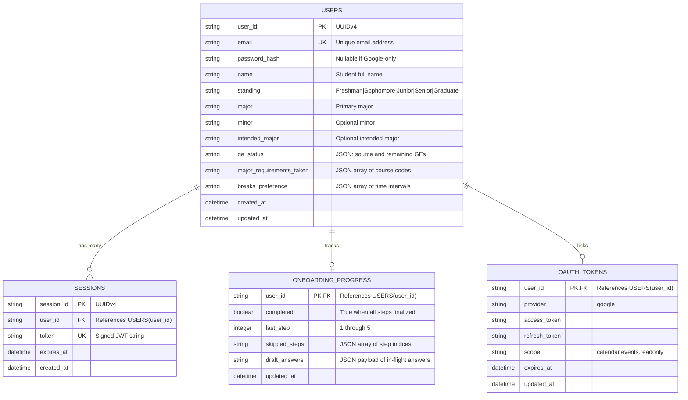
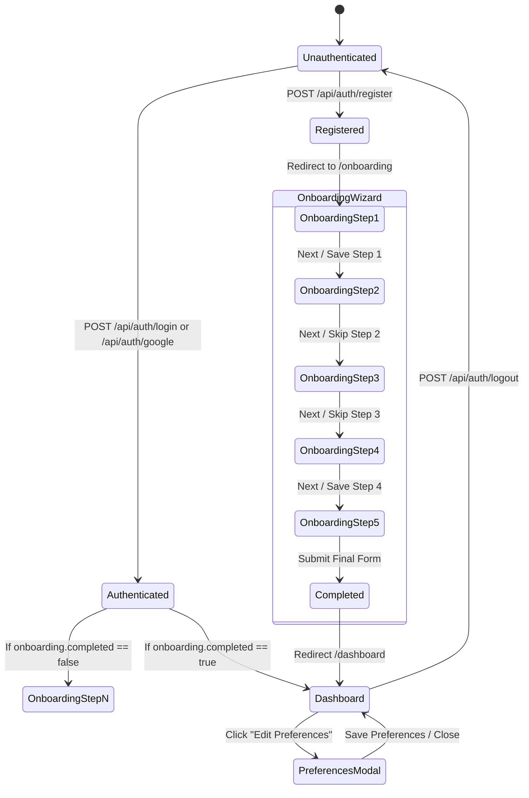

# Data Model: Sprint 1 MVP

This document specifies the database schemas, entity relationships, validation constraints, and lifecycle state transitions for the Sprint 1 MVP.

---

## 1. Entity-Relationship Diagram

---

## 2. Entity Definitions & Field Constraints

### 2.1 User Entity (`users`)
Represents an enrolled student account.

| Field | Type | Nullable | Validation / Constraints |
| :--- | :--- | :--- | :--- |
| `user_id` | TEXT | No | UUIDv4 primary key |
| `email` | TEXT | No | Unique, valid email format (e.g. `@ucsc.edu`) |
| `password_hash` | TEXT | Yes | Bcrypt hash (cost 10); null if registered exclusively via Google OAuth |
| `name` | TEXT | No | 1–100 characters |
| `standing` | TEXT | No | Must be one of: `Freshman`, `Sophomore`, `Junior`, `Senior`, `Graduate` |
| `major` | TEXT | No | 1–100 characters (e.g. `Computer Science B.S.`) |
| `minor` | TEXT | Yes | Optional declared or intended minor |
| `intended_major`| TEXT | Yes | Optional intended major for proposed students |
| `ge_status` | TEXT | Yes | Serialized JSON: `{ source: string, remaining: string[] }` |
| `major_requirements_taken` | TEXT | Yes | Serialized JSON array of course codes: e.g. `["CSE 12", "CSE 13S"]` |
| `breaks_preference` | TEXT | Yes | Serialized JSON array of `TimeWindow` objects |
| `created_at` | DATETIME | No | Default `CURRENT_TIMESTAMP` |
| `updated_at` | DATETIME | No | Default `CURRENT_TIMESTAMP` |

---

### 2.2 Session Entity (`sessions`)
Tracks active cryptographic session tokens.

| Field | Type | Nullable | Validation / Constraints |
| :--- | :--- | :--- | :--- |
| `session_id` | TEXT | No | UUIDv4 primary key |
| `user_id` | TEXT | No | Foreign Key → `users(user_id)` ON DELETE CASCADE |
| `token` | TEXT | No | Unique signed JWT string |
| `expires_at` | DATETIME | No | Expiration timestamp (default: 7 days from issuance) |
| `created_at` | DATETIME | No | Default `CURRENT_TIMESTAMP` |

---

### 2.3 Onboarding Progress Entity (`onboarding_progress`)
Persists wizard state and draft answers across sessions.

| Field | Type | Nullable | Validation / Constraints |
| :--- | :--- | :--- | :--- |
| `user_id` | TEXT | No | Primary Key, Foreign Key → `users(user_id)` ON DELETE CASCADE |
| `completed` | BOOLEAN | No | 0 (false) or 1 (true); default 0 |
| `last_step` | INTEGER | No | Range: 1 to 5; default 1 |
| `skipped_steps`| TEXT | No | JSON array of integers: e.g. `[2, 5]`; default `'[]'` |
| `draft_answers`| TEXT | No | JSON object conforming to `OnboardingQuestionnaireSchema`; default `'{}'` |
| `updated_at` | DATETIME | No | Default `CURRENT_TIMESTAMP` |

---

### 2.4 OAuth Tokens Entity (`oauth_tokens`)
Stores third-party authorization tokens for Google Calendar integrations.

| Field | Type | Nullable | Validation / Constraints |
| :--- | :--- | :--- | :--- |
| `user_id` | TEXT | No | Primary Key, Foreign Key → `users(user_id)` ON DELETE CASCADE |
| `provider` | TEXT | No | Constant `'google'` |
| `access_token` | TEXT | No | Google API bearer token |
| `refresh_token`| TEXT | Yes | Long-lived refresh token for offline calendar querying |
| `scope` | TEXT | No | e.g. `'https://www.googleapis.com/auth/calendar.events.readonly'` |
| `expires_at` | DATETIME | Yes | Timestamp of access token expiry |
| `updated_at` | DATETIME | No | Default `CURRENT_TIMESTAMP` |

---

## 3. User Lifecycle State Machine

