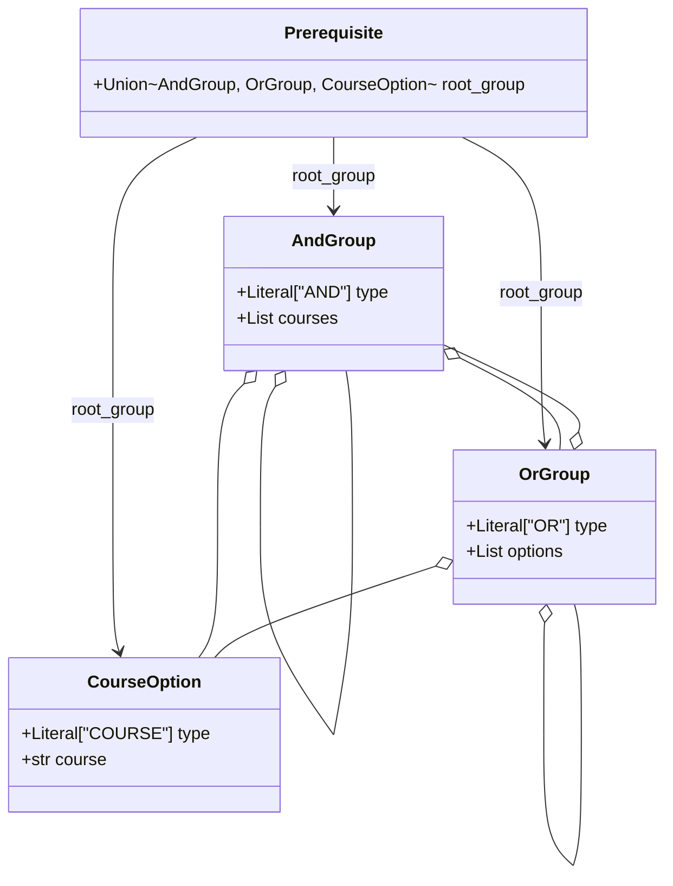

# Data Model: UCSC Academic Catalog, ChromaDB RAG & Prerequisite DAG

**Branch**: `003-catalog-scraping-rag`
**Created**: 2026-11-17
**Feature**: Sprint 3 Task 1 (`docs/tasks/sprint-3/1.md`)

---

## 1. CourseRecord (SQLite Database: `academic_catalog.db`)

Represents an individual course section (lecture, lab, or discussion) scraped from UCSC PISA.

### Schema (`courses` table)

| Column | Type | Constraints | Description | Example |
| :--- | :--- | :--- | :--- | :--- |
| `id` | `INTEGER` | `PRIMARY KEY AUTOINCREMENT` | Unique database identifier | `1` |
| `course_code` | `TEXT` | `NOT NULL` | Department code and number | `"CSE 30"` |
| `section` | `TEXT` | `NOT NULL` | Section designator | `"01"` or `"01A"` |
| `title` | `TEXT` | `NOT NULL` | Official course title | `"Programming Abstractions in Python"` |
| `credits` | `INTEGER` | `NULLABLE` | Credit unit value | `5` |
| `ge` | `TEXT` | `NULLABLE` | General Education category code(s) | `"MF"` or `"PE-T"` |
| `class_number` | `TEXT` | `NULLABLE` | 5-digit PISA class enrollment number | `"20451"` |
| `days` | `TEXT` | `NULLABLE` | Comma-separated meeting days | `"M,W,F"` |
| `start_time` | `TEXT` | `NULLABLE` | 24-hour meeting start time (`HH:MM`) | `"13:20"` |
| `end_time` | `TEXT` | `NULLABLE` | 24-hour meeting end time (`HH:MM`) | `"14:25"` |
| `room` | `TEXT` | `NULLABLE` | Campus building and room name | `"Classroom Unit 002"` |
| `instructor` | `TEXT` | `NULLABLE` | Primary instructor name | `"Alfvén, H."` |
| `meeting_dates` | `TEXT` | `NULLABLE` | Date range of academic session | `"01/06/27-03/19/27"` |
| `raw_prereqs` | `TEXT` | `NULLABLE` | Raw enrollment requirement text from PISA | `"CSE 20 or BME 160; and MATH 19A"` |
| `section_type` | `TEXT` | `NOT NULL DEFAULT 'LECTURE'` | Section category (`LECTURE`, `DISCUSSION`, `LAB`) | `"LECTURE"` |
| `status` | `TEXT` | `NULLABLE` | Enrollment/staffing status from HTML | `"Staff"` or `"Open"` |
| `created_at` | `DATETIME` | `DEFAULT CURRENT_TIMESTAMP` | Record creation timestamp | `"2026-11-17 19:00:00"` |

### Validation Rules
- **No leading/trailing whitespace**: Every text attribute MUST be sanitized with `.strip()` prior to insertion.
- **Time formatting**: Start and end times must match `\d{2}:\d{2}` in 24-hour format if times are present.
- **Days matching**: Days must be extracted using the regex token set `['M', 'Tu', 'W', 'Th', 'F', 'Sa', 'Su']`.
- **Discussion sections**: Must have `section_type = 'DISCUSSION'`. Non-applicable attributes are stored as `None` or `'N/A'`. Meeting dates match the parent lecture course.

---

## 2. DegreeRequirementChunk (ChromaDB Vector Store)

Represents a semantic chunk of degree requirements extracted from UCSC general catalog bachelor's degree pages.

### Collection: `degree_requirements`

| Field | Type | Description | Example |
| :--- | :--- | :--- | :--- |
| `id` | `str` | Deterministic chunk identifier | `"cs_bs_elective_req_002"` |
| `document` | `str` | Text content of the chunk | `"Course CSE 195 may be used either as an elective, or to satisfy the DC requirement, but not for both..."` |
| `embedding` | `List[float]` | 384-dimensional vector from `BAAI/bge-small-en-v1.5` | `[-0.0241, 0.0812, ...]` |
| `metadata` | `dict` | Filterable chunk attributes | See below |

### Metadata Schema
```json
{
  "degree_title": "Computer Science B.S.",
  "concentration": "General",
  "section_heading": "Elective Requirements",
  "url": "https://catalog.ucsc.edu/en/current/general-catalog/academic-units/baskin-engineering/computer-science-and-engineering/computer-science-bs/",
  "chunk_index": 3
}
```

### Chunking Rules
- Split text boundaries at `.expand` class HTML blocks and headings (`h2`, `h3`, `h4`).
- For sections exceeding 350 words, apply a sliding window with a 50-word overlap.
- Prepend section heading context: `f"Degree: {degree_title} | Section: {heading}\n{content}"`.

---

## 3. Prerequisite Logic Tree (`course_dag.json`)

Recursive Pydantic schema representing prerequisite boolean satisfiability.

### Schema Hierarchy



### JSON Structure Example
```json
{
  "CSE 101": {
    "root_group": {
      "type": "AND",
      "courses": [
        {
          "type": "OR",
          "options": [
            {"type": "COURSE", "course": "CSE 13S"},
            {"type": "COURSE", "course": "CSE 13E"}
          ]
        },
        {
          "type": "OR",
          "options": [
            {"type": "COURSE", "course": "CSE 16"},
            {"type": "COURSE", "course": "MATH 21"}
          ]
        }
      ]
    }
  }
}
```

---

## 4. Eligibility Evaluation State Model

Defines the output model returned to the agent when checking student prerequisite eligibility:

```python
class CourseEligibilityStatus:
    course_code: str
    is_eligible: bool
    missing_requirements: List[str]
    raw_prerequisites: str
    explanation: str
```
