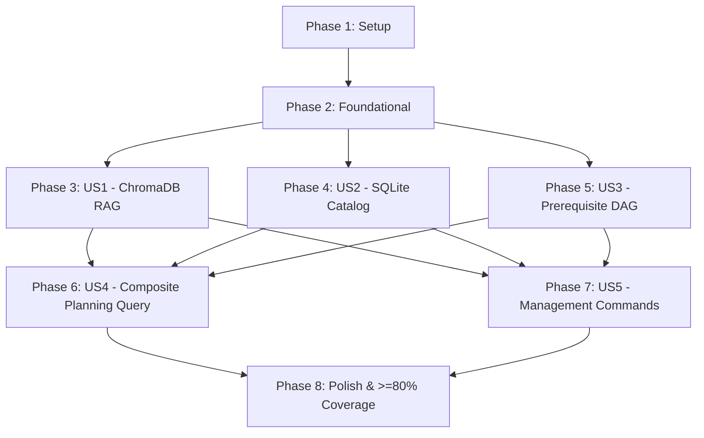

# Tasks: UCSC Academic Catalog Scraping, ChromaDB RAG & Prerequisite DAG

**Input**: Design documents from `specs/003-catalog-scraping-rag/` (`spec.md`, `plan.md`, `research.md`, `data-model.md`, `contracts/`, `quickstart.md`)

**Prerequisites**:
- `specs/003-catalog-scraping-rag/spec.md` (Functional requirements, user stories with priorities P1–P3)
- `specs/003-catalog-scraping-rag/plan.md` (Architecture, components, directory structure)
- `specs/003-catalog-scraping-rag/data-model.md` (SQLite schema, ChromaDB metadata, DAG Pydantic models)
- `specs/003-catalog-scraping-rag/contracts/` (Agent tools and CLI command contracts)

**Test & Coverage Requirement**: Test suite in `agent_service/tests/` MUST achieve at least 80% code coverage per `spec.md` and `1.md`.

**Organization**: Tasks are grouped by user story to enable independent implementation and testing of each story.

---

## Phase 1: Setup (Shared Infrastructure)

**Purpose**: Dependency installation, directory layout, and offline test fixture staging.

- [X] T001 Update `agent_service/requirements.txt` to add `chromadb>=0.5.0`, `sentence-transformers>=3.0.0`, `beautifulsoup4>=4.12.0`, `lxml>=5.0.0`, and `pytest-cov>=5.0.0`
- [X] T002 [P] Create directory structure for data artifacts and management commands at `agent_service/data/chroma_db/`, `agent_service/agent/management/commands/`, and `agent_service/tests/fixtures/`
- [X] T003 [P] Stage static HTML test fixtures in `agent_service/tests/fixtures/` (`pisa_results.html`, `pisa_detail.html`, `bachelors_degrees.html`, `cs_bs.html`) for offline deterministic testing

---

## Phase 2: Foundational (Blocking Prerequisites)

**Purpose**: Core data layer, ChromaDB wrapper, Pydantic schemas, and system prompt required by all user stories.

**⚠️ CRITICAL**: Must be completed before user story implementation begins.

- [X] T004 Implement SQLite database schema and DAO in `agent_service/agent/catalog_dao.py` creating the `courses` table with columns (`course_code`, `section`, `title`, `credits`, `ge`, `class_number`, `days`, `start_time`, `end_time`, `room`, `instructor`, `meeting_dates`, `raw_prereqs`, `section_type`, `status`) and enforcing whitespace stripping (`.strip()`) on every string inserted
- [X] T005 [P] Implement persistent ChromaDB wrapper in `agent_service/agent/chroma_rag.py` configuring collection `degree_requirements` with `BAAI/bge-small-en-v1.5` embeddings and a deterministic mock embedding function for offline tests
- [X] T006 [P] Implement recursive Pydantic prerequisite logic models (`CourseOption`, `OrGroup`, `AndGroup`, `Prerequisite`) in `agent_service/agent/prereq_models.py`
- [X] T007 [P] Update `agent_service/agent_api/prompt_builder.py` to embed the university degree-planning assistant persona, degree grounding constraints, and tool usage rules verbatim from `spec.md`

**Checkpoint**: Foundation ready — database DAO, ChromaDB client, Pydantic models, and prompt builder initialized.

---

## Phase 3: User Story 1 - Degree Requirements Retrieval via ChromaDB (Priority: P1) 🎯 MVP

**Goal**: Scrape bachelor's degree requirements, chunk on `.expand` containers and headings, index into ChromaDB, and provide the `query_degree_requirements` agent tool.

**Independent Test**: Semantic search on ChromaDB for CSE 195 DC/elective policy explicitly returns *"Course CSE 195 may be used either as an elective, or to satisfy the DC requirement, but not for both"*.

### Tests for User Story 1 ⚠️
- [X] T008 [P] [US1] Write unit tests in `agent_service/tests/test_chroma_rag.py` verifying document chunking on `.expand` and headings, concentration metadata tagging, and exact retrieval of the CSE 195 DC/elective clause

### Implementation for User Story 1
- [X] T009 [US1] Implement degree catalog crawler and chunker in `agent_service/agent/degree_scraper.py` extracting bachelor's programs from `catalog.ucsc.edu`, chunking on `.expand` containers and headings with 350-word sliding window (50-word overlap), and isolating concentrations as separate metadata entries
- [X] T010 [US1] Implement `@tool` function `query_degree_requirements(query: str, major: str = "", concentration: str = "") -> str` in `agent_service/agent/tools.py` connecting vector search to the LangChain agent

**Checkpoint**: User Story 1 fully functional and independently testable via `test_chroma_rag.py`.

---

## Phase 4: User Story 2 - Course Schedule, Section, and Time Lookups from SQLite (Priority: P1)

**Goal**: Scrape PISA class search with `binds[:subject] = ""`, parse days/times via regex, store courses and discussion sections in `academic_catalog.db` with zero whitespace, and expose catalog get tools.

**Independent Test**: Can query `academic_catalog.db` for `CSE 30` and retrieve all sections with regex-parsed meeting days, 24-hour start/end times (`HH:MM`), and linked discussion sections with `section_type = 'DISCUSSION'`.

### Tests for User Story 2 ⚠️
- [X] T011 [P] [US2] Write unit tests in `agent_service/tests/test_catalog_dao.py` verifying database table creation, course and discussion insertions, whitespace stripping, and handling of invalid queries / non-existent courses

### Implementation for User Story 2
- [X] T012 [US2] Implement PISA class scraper in `agent_service/agent/pisa_scraper.py` submitting `binds[:subject] = ""` form search, crawling detail pages, regex-matching days (`M|Tu|W|Th|F|Sa|Su`) and 24h start/end times (`%H:%M`), populating discussions with `section_type = 'DISCUSSION'`, and stripping whitespace from all fields
- [X] T013 [US2] Implement catalog get tools in `agent_service/agent/tools.py`: `get_course_details(course_code, section)`, `get_course_sections(course_code)`, and `get_course_time(course_code, section)` querying `academic_catalog.db` via `catalog_dao.py`

**Checkpoint**: User Stories 1 AND 2 both work independently and pass unit test suites.

---

## Phase 5: User Story 3 - Prerequisite Verification & DAG Eligibility (Priority: P1)

**Goal**: Parse prerequisite texts into recursive logic trees (`course_dag.json`), evaluate student eligibility via recursive solver (`is_eligible`), and expose `check_course_prerequisites` tool.

**Independent Test**: Evaluating eligibility for `CSE 40` returns `ELIGIBLE` when student has completed `MATH 19B` and `CSE 30`, and `NOT_ELIGIBLE` when missing either branch.

### Tests for User Story 3 ⚠️
- [X] T014 [P] [US3] Write unit tests in `agent_service/tests/test_dag_solver.py` verifying recursive `is_eligible` evaluation on single courses, nested `AND` groups, and `OR` options against completed course sets

### Implementation for User Story 3
- [X] T015 [US3] Implement prerequisite parser in `agent_service/agent/prereq_parser.py` converting raw prerequisite strings from `academic_catalog.db` into `course_dag.json` using Gemini structured output with an offline regex rule fallback parser
- [X] T016 [US3] Update `agent_service/agent/dag_solver.py` to load `agent_service/data/course_dag.json` dynamically and implement recursive `is_eligible(node, completed_courses)` traversal
- [X] T017 [US3] Implement `@tool` function `check_course_prerequisites(course_code: str, completed_courses: Optional[List[str]] = None) -> str` in `agent_service/agent/tools.py`

**Checkpoint**: All three P1 stories (Vector RAG, SQLite Catalog, and DAG Solver) are independently functional and tested.

---

## Phase 6: User Story 4 - Composite Academic Planning Query & Grounded Synthesis (Priority: P2)

**Goal**: Enable the agent to handle composite queries (e.g. "Do I need to take CSE 101 to graduate? If so which of its prereqs can I take this quarter?") by synthesizing information across all three tool categories.

**Independent Test**: Agent executes `query_degree_requirements`, `check_course_prerequisites`, and `get_course_sections` in sequence and generates a synthesized grounded response.

### Tests for User Story 4 ⚠️
- [X] T018 [P] [US4] Write integration test in `agent_service/tests/test_composite_queries.py` simulating composite student queries and verifying sequential tool execution and answer grounding

### Implementation for User Story 4
- [X] T019 [US4] Register all new tools (`query_degree_requirements`, `get_course_details`, `get_course_sections`, `get_course_time`, `check_course_prerequisites`) in `agent_service/agent/agent.py` for live Gemini tool binding, while verifying `agent_service/agent/mock_agent.py` remains completely untouched

**Checkpoint**: Composite query reasoning verified end-to-end with the live LangChain agent.

---

## Phase 7: User Story 5 - Isolated Ingestion Commands (Priority: P3)

**Goal**: Provide standalone Django management commands to run data ingestion and DAG parsing pipelines independently from the command line.

**Independent Test**: Running each management command generates valid data files in `agent_service/data/`.

### Implementation for User Story 5
- [X] T020 [P] [US5] Implement `agent_service/agent/management/commands/ingest_degrees.py` supporting `--url`, `--limit`, and `--db-path` CLI options
- [X] T021 [P] [US5] Implement `agent_service/agent/management/commands/ingest_pisa.py` supporting `--term`, `--subject`, `--max-pages`, and `--db-path` CLI options
- [X] T022 [P] [US5] Implement `agent_service/agent/management/commands/parse_prereq_dag.py` supporting `--db-path`, `--output`, and `--use-offline-parser` CLI options
- [X] T023 [US5] Write tests in `agent_service/tests/test_management_commands.py` executing the commands via Django's `call_command` and asserting artifact creation

---

## Phase 8: Polish & Cross-Cutting Concerns

**Purpose**: Test coverage enforcement (>= 80%), security boundaries, and validation guide execution.

- [X] T024 [P] Run full test suite with coverage enforcement (`pytest tests/ --cov=agent --cov-report=term-missing`) and verify test coverage is >= 80% across all new and updated modules
- [X] T025 Verify database isolation: Assert that `data/app.db` and root Node server code do NOT import or access `agent_service/data/`
- [X] T026 Execute end-to-end quickstart validation scenarios defined in `specs/003-catalog-scraping-rag/quickstart.md`

---

## Dependencies & Execution Order

### User Story Dependencies
- **User Story 1 (P1)**: Depends on Foundational (Phase 2).
- **User Story 2 (P1)**: Depends on Foundational (Phase 2).
- **User Story 3 (P1)**: Depends on Foundational (Phase 2).
- **User Story 4 (P2)**: Depends on US1, US2, and US3 tool completion.
- **User Story 5 (P3)**: Wraps US1, US2, and US3 scrapers into Django management commands.

---

## Parallel Opportunities

- **Setup Phase**: T002 and T003 can run in parallel.
- **Foundational Phase**: T005, T006, and T007 can run in parallel once T004 is started.
- **User Story Tests**: T008 (US1), T011 (US2), and T014 (US3) can be written in parallel.
- **Management Commands**: T020, T021, and T022 can be implemented in parallel.

---

## Implementation Strategy

### MVP First (User Story 1 & 2 Core)
1. Complete Phase 1: Setup (T001–T003)
2. Complete Phase 2: Foundational (T004–T007)
3. Complete Phase 3: User Story 1 (T008–T010) — Degree requirements RAG
4. Complete Phase 4: User Story 2 (T011–T013) — Course schedule lookups
5. **Validate**: Run unit tests on ChromaDB and SQLite DAO

### Incremental Delivery
1. Add Phase 5: User Story 3 (T014–T017) — Prerequisite DAG reasoning
2. Add Phase 6: User Story 4 (T018–T019) — Composite multi-tool query synthesis
3. Add Phase 7: User Story 5 (T020–T023) — CLI management commands
4. Complete Phase 8: Polish (T024–T026) — Verify >= 80% coverage and isolation boundaries
