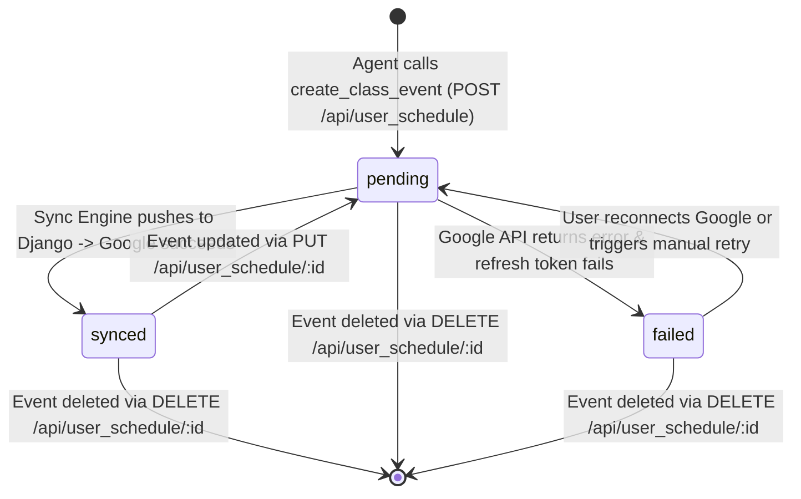

# Data Model: Interactive Calendar UI & Sync Engine

**Feature**: `specs/004-calendar-ui-sync`  
**Date**: 2026-11-18  

---

## 1. Relational Entities (SQLite `data/app.db`)

### Table: `user_settings`
Tracks individual user preferences for external calendar synchronization.

| Column | Type | Constraints | Description |
|---|---|---|---|
| `user_id` | TEXT | PRIMARY KEY, REFERENCES users(user_id) ON DELETE CASCADE | Unique ID of the student |
| `sync_enabled` | BOOLEAN | NOT NULL DEFAULT 1 | User toggle to pause/resume Google sync |
| `is_connected_to_google` | BOOLEAN | NOT NULL DEFAULT 0 | Whether Google OAuth is currently linked |
| `updated_at` | DATETIME | DEFAULT CURRENT_TIMESTAMP | Last settings modification timestamp |

### Table: `user_schedule`
Replaces `user_calendar_events` as the production schedule store with sync state tracking.

| Column | Type | Constraints | Description |
|---|---|---|---|
| `id` | TEXT | PRIMARY KEY | Unique UUID for the schedule event |
| `user_id` | TEXT | NOT NULL, REFERENCES users(user_id) ON DELETE CASCADE | Owner of the schedule event |
| `course_code` | TEXT | NOT NULL | Course identifier (e.g. `CSE 30`) |
| `title` | TEXT | NOT NULL | Course title (e.g. `Programming Abstractions`) |
| `description` | TEXT | DEFAULT '' | Description / section details / room / instructor |
| `days` | TEXT | NOT NULL | Meeting days format: `M,W,F` or `MWF` |
| `start_time` | TEXT | NOT NULL | 24-hour start time format (`HH:MM`) |
| `end_time` | TEXT | NOT NULL | 24-hour end time format (`HH:MM`) |
| `start_date` | TEXT | NOT NULL | Academic quarter start date (`YYYY-MM-DD`) |
| `end_date` | TEXT | NOT NULL | Academic quarter end date (`YYYY-MM-DD`) |
| `is_imported` | BOOLEAN | NOT NULL DEFAULT 0 | 1 = External calendar block; 0 = Local class |
| `sync_status` | TEXT | NOT NULL CHECK (sync_status IN ('pending', 'synced', 'failed')) | Sync state for the sync engine |
| `google_event_id` | TEXT | DEFAULT NULL | External ID returned by Google Calendar API |
| `created_at` | DATETIME | DEFAULT CURRENT_TIMESTAMP | Record creation timestamp |

---

## 2. Event State Machine



---

## 3. Shared TypeScript Interfaces & Schemas (`shared/src/`)

```typescript
export type SyncStatus = 'pending' | 'synced' | 'failed';

export interface UserScheduleItem {
  id: string;
  userId: string;
  courseCode: string;
  title: string;
  description: string;
  days: string;
  startTime: string;
  endTime: string;
  startDate: string;
  endDate: string;
  isImported: boolean;
  syncStatus: SyncStatus;
  googleEventId: string | null;
  createdAt: string;
}

export interface UserSettings {
  userId: string;
  syncEnabled: boolean;
  isConnectedToGoogle: boolean;
  updatedAt: string;
}

export interface CreateScheduleEventDTO {
  courseCode: string;
  title: string;
  description?: string;
  days: string;
  startTime: string;
  endTime: string;
  startDate?: string;
  endDate?: string;
  isImported?: boolean;
}

export interface UpdateScheduleEventDTO {
  title?: string;
  description?: string;
  days?: string;
  startTime?: string;
  endTime?: string;
}
```

---

## 4. FullCalendar Mapping Representation

FullCalendar consumes recurring weekly class blocks using standard event object shapes:

```typescript
export interface FullCalendarEventInput {
  id: string;
  title: string;
  daysOfWeek: number[]; // e.g. [1, 3, 5] for Mon, Wed, Fri
  startTime: string;    // e.g. "10:00:00"
  endTime: string;      // e.g. "11:05:00"
  startRecur: string;   // e.g. "2027-01-04"
  endRecur: string;     // e.g. "2027-03-19"
  backgroundColor?: string;
  borderColor?: string;
  textColor?: string;
  extendedProps: {
    courseCode: string;
    isImported: boolean;
    syncStatus: SyncStatus;
    description: string;
  };
}
```
