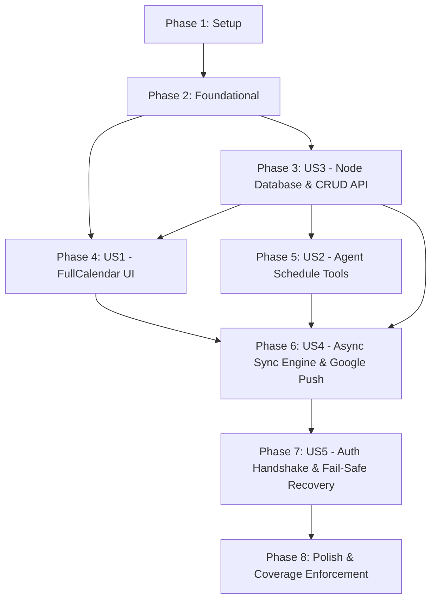

# Tasks: Interactive Calendar UI & Sync Engine

**Input**: Design documents from `specs/004-calendar-ui-sync/` (`spec.md`, `plan.md`, `research.md`, `data-model.md`, `contracts/`, `quickstart.md`)

**Prerequisites**:
- `specs/004-calendar-ui-sync/spec.md` (User stories with priorities P1–P2)
- `specs/004-calendar-ui-sync/plan.md` (Architecture, components, directory structure)
- `specs/004-calendar-ui-sync/data-model.md` (Relational schema, state machine, DTOs)
- `specs/004-calendar-ui-sync/contracts/` (User schedule CRUD, sync engine, agent tools)

**Tests & Coverage Requirement**:
- Server test suite in `server/tests/` must pass with full coverage for new CRUD and sync engine logic.
- Agent service test suite in `agent_service/tests/` MUST achieve at least 80% code coverage.
- Client tests in `client/src/` must pass for FullCalendar event mapping and status rendering.

**Organization**: Tasks are grouped by user story to enable independent implementation and testing of each story.

---

## Phase 1: Setup (Shared Infrastructure)

**Purpose**: Dependency installation and shared schema definitions across client, server, and agent service.

- [X] T001 Install `@fullcalendar/react`, `@fullcalendar/core`, and `@fullcalendar/timegrid` in `client/package.json`
- [X] T002 [P] Define shared TypeScript interfaces (`UserScheduleItem`, `UserSettings`, `CreateScheduleEventDTO`, `UpdateScheduleEventDTO`) and Zod schemas in `shared/src/schemas/schedule.schema.ts`
- [X] T003 [P] Re-export schedule schemas and types in `shared/src/index.ts` and compile shared package via `npm run build` in `shared/`

---

## Phase 2: Foundational (Blocking Prerequisites)

**Purpose**: Database schema creation and DAO query layers required by all user stories.

**⚠️ CRITICAL**: Must be completed before user story implementation begins.

- [X] T004 Update SQLite DDL in `server/src/db/schema.sql` to add `user_settings` (`user_id`, `sync_enabled`, `is_connected_to_google`) and `user_schedule` (`id`, `user_id`, `course_code`, `title`, `description`, `days`, `start_time`, `end_time`, `start_date`, `end_date`, `is_imported`, `sync_status`, `google_event_id`, `created_at`) with foreign key constraints referencing `users(user_id)`
- [X] T005 [P] Implement `server/src/db/queries/settingsQueries.ts` supporting `getUserSettings`, `upsertUserSettings`, and `updateGoogleConnection`
- [X] T006 [P] Implement `server/src/db/queries/scheduleQueries.ts` supporting `getScheduleByUserId`, `createScheduleEvent`, `updateScheduleEvent`, `deleteScheduleEvent`, `getPendingEvents`, and `updateSyncStatus`
- [X] T007 Run database migration and verification in `server/src/db/database.ts` ensuring `user_settings` and `user_schedule` tables and indexes are initialized

**Checkpoint**: Foundation ready — database schema and query DAOs initialized.

---

## Phase 3: User Story 3 - Production Database Schema & Node CRUD API (Priority: P1)

**Goal**: Expose robust Node.js REST endpoints (`GET`, `POST`, `PUT`, `DELETE` at `/api/user_schedule`) enforcing authentication, multi-user isolation, and default `sync_status = 'pending'`.

**Independent Test**: Calling Node CRUD endpoints creates, updates, queries, and deletes events in `user_schedule` for authenticated students.

### Tests for User Story 3 ⚠️
- [X] T008 [P] [US3] Write unit and integration tests in `server/tests/schedule.routes.test.ts` testing `GET /api/user_schedule`, `POST /api/user_schedule`, `PUT /api/user_schedule/:id`, and `DELETE /api/user_schedule/:id` with auth verification and foreign key enforcement

### Implementation for User Story 3
- [X] T009 [US3] Implement Express controller and router in `server/src/routes/schedule.routes.ts` validating requests with Zod schemas and calling `scheduleQueries`
- [X] T010 [US3] Register `/api/user_schedule` router in `server/src/app.ts` with `requireAuth` middleware

**Checkpoint**: User Story 3 fully functional; schedule records can be manipulated via standard REST APIs.

---

## Phase 4: User Story 1 - Interactive Local-First FullCalendar Display (Priority: P1) 🎯 MVP

**Goal**: Replace the custom placeholder calendar in React with `<FullCalendar>` in `timeGridWeek` view, rendering recurring weekly courses, gray-styling imported external events, and enforcing read-only behavior.

**Independent Test**: Dashboard displays `<FullCalendar>` rendering weekly classes with correct time blocks and recurring days (`daysOfWeek`), with imported events rendered in gray and no direct drag-and-drop creation.

### Tests for User Story 1 ⚠️
- [X] T011 [P] [US1] Write unit tests in `client/src/utils/calendarMapping.test.ts` validating conversion from SQLite rows (`days: "M,W,F"`, `10:00`-`11:05`) to FullCalendar event inputs (`daysOfWeek: [1, 3, 5]`, `startTime`, `endTime`, `startRecur`, `endRecur`, gray styling for `is_imported = true`)

### Implementation for User Story 1
- [X] T012 [P] [US1] Implement schedule API client methods (`fetchSchedule`, `deleteScheduleEvent`) in `client/src/services/scheduleService.ts`
- [X] T013 [P] [US1] Implement event mapping utility `client/src/utils/calendarMapping.ts` mapping `UserScheduleItem` array to FullCalendar event format
- [X] T014 [US1] Replace placeholder timetable in `client/src/components/dashboard/CalendarPreview.tsx` with `<FullCalendar>` component configured with `timeGridWeek`, `hiddenDays: [0, 6]`, `slotMinTime: "08:00:00"`, `slotMaxTime: "20:00:00"`, `editable: false`, and `selectable: false`
- [X] T015 [US1] Add visual distinction for `is_imported = true` events (gray background `#64748b` with `[External]` badge) and render sync status pills (`pending`, `synced`, `failed`) inside `client/src/components/dashboard/CalendarPreview.tsx`

**Checkpoint**: User Story 1 fully functional — student schedule is visually rendered on FullCalendar.

---

## Phase 5: User Story 2 - Agent-Controlled Schedule Mutations (Priority: P1)

**Goal**: Enable Sammy the Slug to add and delete scheduled classes via `@tool` functions that hit Node's `/api/user_schedule` with forwarded Bearer authentication, while strictly isolating Google MCP tools to read-only mode.

**Independent Test**: Asking Sammy in chat to add a course executes `create_class_event` which hits Node `POST /api/user_schedule` and inserts a `pending` row; agent cannot call any Google MCP write operations.

### Tests for User Story 2 ⚠️
- [X] T016 [P] [US2] Write unit tests in `agent_service/tests/test_schedule_tools.py` testing `create_class_event` and `delete_class_event` HTTP interactions with mocked Node endpoints and session token forwarding

### Implementation for User Story 2
- [X] T017 [US2] Implement `@tool create_class_event(course_code: str, section: str = "01")` in `agent_service/agent/tools.py` fetching meeting times from `academic_catalog.db` and posting to Node `POST /api/user_schedule`
- [X] T018 [US2] Implement `@tool delete_class_event(course_code: str)` in `agent_service/agent/tools.py` sending HTTP DELETE to Node `/api/user_schedule/:id`
- [X] T019 [US2] Update `server/src/services/agent.service.ts` to forward the student's Bearer session token in the request payload/headers when calling Django `POST /api/agent/process/`
- [X] T020 [US2] Update LangGraph/LangChain agent tool bindings in `agent_service/agent/agent.py` to register `create_class_event` and `delete_class_event` while strictly excluding Google MCP write tools (`create_event`, `update_event`, `delete_event`)

**Checkpoint**: User Stories 1, 2, and 3 work together end-to-end; agent creates and deletes local events rendered on FullCalendar.

---

## Phase 6: User Story 4 - Asynchronous Sync Engine & Google Push (Priority: P2)

**Goal**: Implement the dual-triggered sync pipeline in Node querying pending non-imported events and invoking Django's `/api/sync/push` endpoint to push classes to Google Calendar API.

**Independent Test**: Calling the sync engine pushes pending rows in `user_schedule` to Django `/api/sync/push`, receives `google_event_id`, and marks rows as `synced`.

### Tests for User Story 4 ⚠️
- [X] T021 [P] [US4] Write unit tests in `agent_service/tests/test_sync_push.py` testing Django `POST /api/sync/push/` with mocked Google Calendar API responses and RRULE generation
- [X] T022 [P] [US4] Write unit tests in `server/tests/syncEngine.test.ts` testing `SyncEngineService.syncUserSchedule` querying pending items, dispatching to Django, and updating sync states

### Implementation for User Story 4
- [X] T023 [US4] Implement Django view `push_event_to_google` in `agent_service/agent_api/views.py` and register in `agent_service/agent_api/urls.py` (`POST /api/sync/push/`) translating course days/times into Google Calendar events with recurring RRULE
- [X] T024 [US4] Implement `SyncEngineService` in `server/src/services/syncEngine.service.ts` querying `WHERE sync_status = 'pending' AND is_imported = 0`, checking `user_settings`, fetching Google token from `oauth_tokens`, and calling Django `/api/sync/push/`
- [X] T025 [US4] Implement manual sync endpoint in `server/src/routes/sync.routes.ts` (`POST /api/sync/run`) and register in `server/src/app.ts`
- [X] T026 [US4] Hook automated sync triggering into `server/src/routes/schedule.routes.ts` upon event creation/updates and into `server/src/services/google.service.ts` upon successful OAuth connection

**Checkpoint**: User Story 4 fully functional; pending local classes are asynchronously pushed to Google Calendar.

---

## Phase 7: User Story 5 - Authentication Handshake & Fail-Safe Recovery (Priority: P2)

**Goal**: Provide smooth OAuth connection flow for email/password students, automatic Google token refresh recovery upon 401 errors, and fail-safe error state management without losing local events.

**Independent Test**: When Google API returns 401 during sync push, Node automatically refreshes the token using `refresh_token` and retries; if refresh fails, event status transitions to `'failed'` without data loss.

### Tests for User Story 5 ⚠️
- [X] T027 [P] [US5] Add unit tests in `server/tests/syncEngine.test.ts` testing automatic token refresh retry logic on 401 Unauthorized, and transition to `failed` status when refresh fails

### Implementation for User Story 5
- [X] T028 [US5] Add token refresh recovery logic in `server/src/services/syncEngine.service.ts` calling Google token endpoint with `refresh_token` from `oauth_tokens` and updating the database with the new access token
- [X] T029 [US5] Add "Sync to Google Calendar" button (for unlinked accounts) and "Sync Now" button (with loading spinner and status banner) in `client/src/components/dashboard/CalendarPreview.tsx`
- [X] T030 [US5] Add failure alert and retry action in `client/src/components/dashboard/CalendarPreview.tsx` when events have `sync_status = 'failed'`

**Checkpoint**: All user stories functional with full fail-safe recovery and offline protection.

---

## Phase 8: Polish & Cross-Cutting Concerns

**Purpose**: Test coverage verification (>= 80% on agent_service, full pass on server/client), database isolation audit, and quickstart scenario validation.

- [X] T031 [P] Run full test suite in `agent_service/` with coverage enforcement (`pytest tests/ --cov=agent --cov-report=term-missing`) and verify test coverage remains >= 80%
- [X] T032 [P] Run full test suite in `server/` (`npm test`) and `client/` (`npm test`) ensuring all test suites pass cleanly
- [X] T033 Verify database isolation: Assert that Django `agent_service/` never directly accesses or imports Node's `data/app.db`
- [X] T034 Execute end-to-end quickstart validation scenarios defined in `specs/004-calendar-ui-sync/quickstart.md`

---

## Dependencies & Execution Order

### User Story Dependencies
- **User Story 3 (P1)**: Depends on Foundational (Phase 2). Delivers database tables and Node CRUD API.
- **User Story 1 (P1)**: Depends on Phase 2 & US3. Delivers FullCalendar UI populated from local Node API.
- **User Story 2 (P1)**: Depends on US3. Delivers Agent mutation tools hitting Node CRUD API.
- **User Story 4 (P2)**: Depends on US1, US2, and US3. Delivers Sync Engine pushing pending events to Django -> Google.
- **User Story 5 (P2)**: Depends on US4. Delivers Token refresh recovery, auth buttons, and failure handling.

---

## Parallel Opportunities

- **Setup Phase**: T001, T002, and T003 can run in parallel.
- **Foundational Phase**: T005 and T006 can run in parallel once T004 is started.
- **User Story Tests**: T008 (US3), T011 (US1), T016 (US2), and T021/T022 (US4) can be written in parallel.
- **Implementation Tasks**:
  - T012 and T013 (client mapping & service) can run in parallel.
  - T017 and T018 (agent tools) can run in parallel.
  - T023 (Django push) and T024 (Node Sync Engine) can run in parallel.

---

## Implementation Strategy

### MVP First (User Stories 3 & 1)
1. Complete Phase 1: Setup (T001–T003)
2. Complete Phase 2: Foundational (T004–T007)
3. Complete Phase 3: User Story 3 (T008–T010) — Database & CRUD API
4. Complete Phase 4: User Story 1 (T011–T015) — FullCalendar display
5. **Validate**: Local calendar renders classes fetched from SQLite.

### Incremental Delivery
1. Add Phase 5: User Story 2 (T016–T020) — Agent creates/deletes events via chat
2. Add Phase 6: User Story 4 (T021–T026) — Asynchronous Google Calendar sync
3. Add Phase 7: User Story 5 (T027–T030) — Token refresh recovery and UI controls
4. Complete Phase 8: Polish (T031–T034) — Verify >= 80% coverage on agent service and pass all tests
