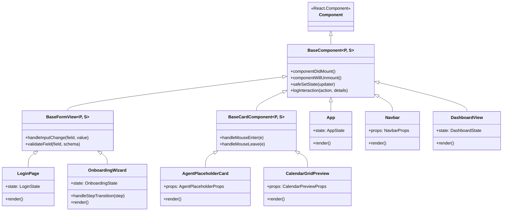
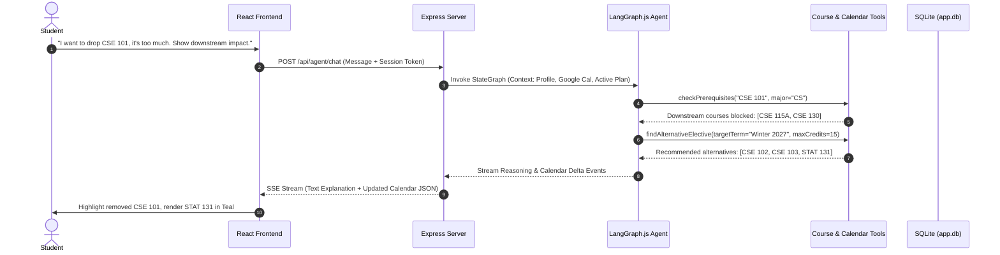
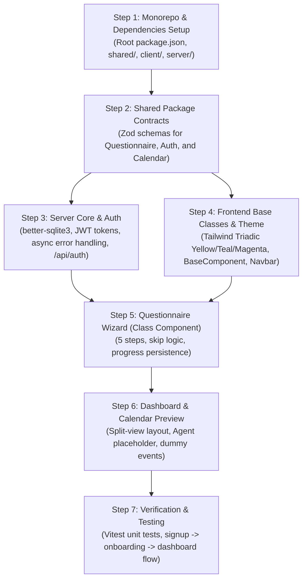

# Sprint 1 MVP Implementation Plan — Smart Scheduling App

This document outlines the detailed architecture, component hierarchy, event handling, styling system, backend design, security protocols, agent integration proposal, and Google Cloud requirements for the Sprint 1 MVP of the Smart Scheduling App.

---

## 1. Frontend React Architecture: Class Components & Inheritance

To satisfy object-oriented component design requirements, the UI layer is structured with typed React Class components utilizing a base component inheritance hierarchy for shared lifecycle management, state synchronization, and event binding.

### 1.1 Inheritance Hierarchy & Base Components



### 1.2 Component Specifications, State, and Props

#### A. Base Classes
* **`BaseComponent<P, S>`**:
  * Extends `React.Component<P, S>`.
  * Manages `_isMounted` tracking to prevent memory leaks during async API calls.
  * Contains helper `safeSetState(updater: Partial<S> | ((prev: S) => Partial<S>))` ensuring unmounted components never update state.

* **`BaseFormView<P, S>`**:
  * Inherits from `BaseComponent<P, S>`.
  * Encapsulates standard form input event bubbling and validation state.

* **`BaseCardComponent<P, S>`**:
  * Inherits from `BaseComponent<P, S>`.
  * Manages visual hover transitions and focus elevation handlers.

#### B. Concrete Application Components
1. **`App` (Root Class Component)**:
   * **Parent State (`AppState`)**:
     * `user: UserProfile | null`
     * `token: string | null`
     * `activeView: 'LOGIN' | 'ONBOARDING' | 'DASHBOARD' | 'PREFERENCES_MODAL'`
     * `onboardingProgress: OnboardingProgress`
     * `isLoading: boolean`
     * `errorNotification: string | null`
   * **Passes Props to Children**:
     * To `Navbar`: `user`, `onOpenPreferences`, `onLogout`, `onNavigate`
     * To `LoginPage`: `onAuthSuccess: (token, user) => void`
     * To `OnboardingWizard`: `initialData`, `onSaveStep: (step, data) => void`, `onComplete: () => void`
     * To `DashboardView`: `user`, `preferences`, `calendarEvents`

2. **`Navbar` (Class Component)**:
   * **Props (`NavbarProps`)**:
     * `user: UserProfile | null`
     * `onEditPreferencesClick: () => void`
     * `onLogoutClick: () => void`
     * `activeTerm: string`
   * **State (`NavbarState`)**:
     * `isDropdownOpen: boolean`
     * `isPreferencesHovered: boolean`

3. **`OnboardingWizard` (Class Component)**:
   * **Inherits**: `BaseFormView<OnboardingWizardProps, OnboardingWizardState>`
   * **Parent State (`OnboardingWizardState`)**:
     * `currentStep: number` (1 to 5)
     * `formData: OnboardingQuestionnaire`
     * `skippedSteps: number[]`
     * `isSubmitting: boolean`
     * `activeFieldHover: string | null`
   * **Props Passed to Step Children**:
     * `values: Partial<OnboardingQuestionnaire>`
     * `onChange: (field: string, val: any) => void`
     * `onSkip: () => void`
     * `onNext: () => void`
     * `onBack: () => void`

4. **`DashboardView` (Class Component)**:
   * **State (`DashboardState`)**:
     * `selectedCourseId: string | null`
     * `hoveredTimeSlot: string | null`
     * `isAgentDrawerCollapsed: boolean`
   * **Child Props Allocation**:
     * Passes `agentStatus`, `onPromptSubmit` to `AgentPlaceholderCard`.
     * Passes `events`, `onEventClick`, `onEventHover` to `CalendarGridPreview`.

---

## 2. Interactive Event Handlers: `onClick` & `onHover` Customizations

Every interactive component implements dedicated, cleanly typed event handlers.

```typescript
// Example from CalendarGridPreview.tsx and CourseCard.tsx
export class CourseCardComponent extends BaseCardComponent<CourseCardProps, CourseCardState> {
  constructor(props: CourseCardProps) {
    super(props);
    this.state = { isHovered: false, isFocused: false };
    this.handleCustomMouseEnter = this.handleCustomMouseEnter.bind(this);
    this.handleCustomMouseLeave = this.handleCustomMouseLeave.bind(this);
    this.handleCustomClick = this.handleCustomClick.bind(this);
  }

  handleCustomMouseEnter(event: React.MouseEvent<HTMLDivElement>): void {
    this.setState({ isHovered: true });
    this.props.onCourseHover(this.props.course.id, true, event);
  }

  handleCustomMouseLeave(event: React.MouseEvent<HTMLDivElement>): void {
    this.setState({ isHovered: false });
    this.props.onCourseHover(this.props.course.id, false, event);
  }

  handleCustomClick(event: React.MouseEvent<HTMLDivElement>): void {
    event.preventDefault();
    this.props.onCourseSelect(this.props.course.id);
  }
}
```

* **Hover customization functions**:
  * `handlePreferencesHover(isHovered: boolean)`: Changes navbar button illumination with Triadic Yellow border glow.
  * `handleCourseCardHover(courseId: string, isEntering: boolean)`: Highlights all matching meeting time slots across the calendar grid simultaneously.
  * `handleStepPillHover(stepIdx: number, isEntering: boolean)`: Displays a floating tooltip describing the section.
* **Click customization functions**:
  * `handleEditPreferencesClick()`: Triggers slide-over drawer or modal preserving ongoing schedule state.
  * `handleQuestionSkipClick(stepIndex: number)`: Records skip payload in database and advances wizard.
  * `handleGoogleAuthClick()`: Initiates Google Identity Services token exchange flow.

---

## 3. Styling & Color Palette Implementation

The application styling follows the required **Triadic Yellow + Teal + Magenta** palette integrated into Tailwind CSS and CSS root variables:

```css
:root {
  /* Triadic Core Palette */
  --color-teal: #00B4DB;       /* Primary Action / Headers / Major Courses */
  --color-teal-hover: #0098ba;
  --color-magenta: #FF6B6B;    /* Accents / Alerts / Elective Badges / Error States */
  --color-magenta-hover: #fa5252;
  --color-yellow: #F9CA24;     /* Attention / Active Step / Warnings / Highlights */
  --color-yellow-hover: #e5b613;

  /* Supporting Neutrals */
  --bg-primary: #F8FAFC;
  --bg-surface: #FFFFFF;
  --border-subtle: #E2E8F0;
  --text-primary: #1A202C;
  --text-muted: #64748B;
}
```

### Tailwind Config Extension (`client/tailwind.config.js`)
```javascript
module.exports = {
  content: ['./src/**/*.{js,ts,jsx,tsx}'],
  theme: {
    extend: {
      colors: {
        triadic: {
          teal: { DEFAULT: '#00B4DB', hover: '#0098ba', light: '#E0F7FA' },
          magenta: { DEFAULT: '#FF6B6B', hover: '#fa5252', light: '#FFEBEB' },
          yellow: { DEFAULT: '#F9CA24', hover: '#e5b613', light: '#FFFDE7' },
        },
      },
    },
  },
  plugins: [],
};
```

---

## 4. UI Layout: Navbar & Reserved Spaces

### 4.1 Top Navigation Bar (`Navbar.tsx`)
```text
+-----------------------------------------------------------------------------------------------------------------+
| [LOGO: SlugSchedule]   Smart Scheduling UCSC   | Target: [Winter 2027 ▾] | [✏️ Edit Preferences]  [Google User ▾] |
+-----------------------------------------------------------------------------------------------------------------+
```
* **Reserved Logo Area**: Left-anchored branding container (`w-48 h-12 flex items-center space-x-2`).
* **Preferences Space**: Prominent navbar button styled with `border-triadic-teal text-triadic-teal hover:bg-triadic-teal hover:text-white` with a pencil icon trigger that opens the preferences modal.
* **Google Account Status**: Shows user avatar, sync badge, and logout action.

### 4.2 Dashboard Layout: Reserved Agent Placeholder & Calendar Grid
The dashboard splits into a 38% / 62% two-column layout:

```text
+----------------------------------------------------+----------------------------------------------------+
| LEFT PANEL (38%): AGENT INTEGRATION PLACEHOLDER    | RIGHT PANEL (62%): WEEKLY CALENDAR PREVIEW         |
|                                                    |                                                    |
| +------------------------------------------------+ | +------------------------------------------------+ |
| | [🤖 SlugAgent Workspace — Sprint 2 Integration] | | |  Monday   Tuesday   Wednesday Thursday Friday  | |
| |------------------------------------------------| | | 08:00                                          | |
| | [Sprint 2 Feature Preview Badge: Magenta]      | | | 09:00 [CSE 115A - MWF 9:00 - Teal Card]        | |
| | "The autonomous scheduling agent will reside   | | | 10:00                                          | |
| |  here to negotiate constraints, drop courses,  | | | 11:00 [Work Shift - Google Cal - Yellow Badge] | |
| |  and explain prerequisite paths."              | | | 12:00 [=== Lunch Break ===]                    | |
| |                                                | | | 01:00 [MATH 21 - TuTh - Teal Card]             | |
| | [Sample Prompt Chips: Disabled / Preview Only] | | | 02:00                                          | |
| |  - "Explain recommendation"                    | | | 03:00 [ART 10F - GE - Magenta Card]            | |
| |  - "This course load is too heavy"             | | | 04:00                                          | |
| |------------------------------------------------| | | 05:00                                          | |
| | [Input Placeholder: "Agent coming in Sprint 2"]| | +------------------------------------------------+ |
| +------------------------------------------------+ |                                                    |
+----------------------------------------------------+----------------------------------------------------+
```

---

## 5. Node.js Backend Structure: Clean Async Patterns & Error Handling

To satisfy Requirement 6 ("limit nested callbacks and enforce error handling"), the backend strictly avoids callback nesting by employing **Async/Await Service Layers**, **Async Controller Wrappers**, and a **Centralized Error-Handling Middleware**.

### 5.1 Architecture Pattern (Controller-Service-Repository)
* **Routes**: Pure routing, parameter extraction, and schema validation middleware.
* **Services**: Business logic using `async/await` returning Promises.
* **DB Queries**: Synchronous SQLite calls via `better-sqlite3` wrapped cleanly without callback pyramid structures.

### 5.2 Async Error Wrapper
```typescript
// server/src/middleware/asyncHandler.ts
import { Request, Response, NextFunction, RequestHandler } from 'express';

export const asyncHandler = (fn: (req: Request, res: Response, next: NextFunction) => Promise<any>): RequestHandler => {
  return (req, res, next) => {
    Promise.resolve(fn(req, res, next)).catch(next);
  };
};
```

### 5.3 Centralized Error Handling Middleware
```typescript
// server/src/middleware/errorHandler.ts
import { Request, Response, NextFunction } from 'express';
import { ZodError } from 'zod';

export interface AppError extends Error {
  statusCode?: number;
  code?: string;
}

export const errorHandler = (err: AppError, req: Request, res: Response, next: NextFunction): void => {
  const statusCode = err.statusCode || 500;
  
  if (err instanceof ZodError) {
    res.status(400).json({
      success: false,
      error: 'VALIDATION_ERROR',
      details: err.errors.map(e => ({ path: e.path.join('.'), message: e.message })),
    });
    return;
  }

  res.status(statusCode).json({
    success: false,
    error: err.code || 'INTERNAL_SERVER_ERROR',
    message: err.message || 'An unexpected error occurred',
  });
};
```

---

## 6. Security: Tokenization and Signatures

To satisfy Requirement 7, authentication and session tokens employ **cryptographic signing and verification** using HMAC-SHA256 (JWT):

### 6.1 Token Generation & Signature
```typescript
// server/src/services/token.service.ts
import jwt from 'jsonwebtoken';
import { config } from '../config';

export interface TokenPayload {
  userId: string;
  email: string;
  standing: string;
  iat?: number;
  exp?: number;
}

export class TokenService {
  static generateSessionToken(payload: TokenPayload): string {
    return jwt.sign(payload, config.JWT_SECRET, {
      expiresIn: '7d',
      algorithm: 'HS256',
    });
  }

  static verifyAndDecode(token: string): TokenPayload {
    return jwt.verify(token, config.JWT_SECRET, {
      algorithms: ['HS256'],
    }) as TokenPayload;
  }
}
```

### 6.2 Authentication Guard Middleware
```typescript
// server/src/middleware/auth.ts
export const requireAuth = (req: AuthenticatedRequest, res: Response, next: NextFunction): void => {
  const authHeader = req.headers.authorization;
  if (!authHeader?.startsWith('Bearer ')) {
    res.status(401).json({ success: false, error: 'MISSING_OR_MALFORMED_TOKEN' });
    return;
  }

  const token = authHeader.split(' ')[1];
  try {
    const payload = TokenService.verifyAndDecode(token);
    req.user = payload;
    next();
  } catch (error) {
    res.status(401).json({ success: false, error: 'INVALID_OR_EXPIRED_SIGNATURE' });
  }
};
```

---

## 7. Proposal: How the Agent Will Be Integrated (Sprints 2 & 3)

### 7.1 Architecture & Workflow
The Agent is architected as an autonomous conversational graph utilizing **LangGraph.js** running in the Node.js backend.



### 7.2 Tool-Calling Specifications
The Agent will execute 4 core tools:
1. **`queryClassCatalog`**: Searches pre-scraped UCSC course offerings by term, department, and available seats.
2. **`inspectPrerequisiteDAG`**: Traverses the major course prerequisite graph to calculate shortest paths and alert students of delayed graduation timelines when dropping a course.
3. **`getGoogleCalendarBusyBlocks`**: Queries stored Google OAuth tokens to extract conflicts (e.g. work shifts, sports practices) as soft constraints.
4. **`solveScheduleConstraints`**: Generates conflict-free combinations matching the student's credit target and break preferences.

### 7.3 Frontend-to-Backend Streaming
* **Protocol**: Server-Sent Events (SSE) via `GET /api/agent/stream`.
* **Payload**: Two-part stream:
  1. `type: "THINKING"` / `type: "MESSAGE"`: Natural language explanation and justification.
  2. `type: "CALENDAR_UPDATE"`: Structured schedule delta that updates `DashboardView`'s calendar state in real time without refreshing.

---

## 8. Requirements from the User for Google Cloud

To integrate Google Sign-In and Google Calendar access, here is the exact checklist of what is needed:

1. **Google Cloud Project**:
   * A project created at [console.cloud.google.com](https://console.cloud.google.com) (e.g., named `slug-smart-scheduling`).
2. **Enable Google Calendar API**:
   * Navigate to **APIs & Services > Library** and enable **Google Calendar API**.
3. **Configure OAuth Consent Screen**:
   * User Type: **External** (in Testing mode).
   * App name: `Smart Scheduling App`.
   * Add Test Users: Add the developer/evaluator `@ucsc.edu` or Gmail email addresses.
   * Scopes to add:
     * `.../auth/userinfo.email`
     * `.../auth/userinfo.profile`
     * `https://www.googleapis.com/auth/calendar.events.readonly`
4. **Credentials Generated**:
   * Create an **OAuth 2.0 Client ID (Web Application)**.
   * **Authorized JavaScript Origins**: `http://localhost:5173`
   * **Authorized Redirect URIs**: `http://localhost:5173` and `http://localhost:3001/api/auth/google/callback`
5. **Environment Variables to Provide in `.env`**:
   ```env
   GOOGLE_CLIENT_ID="<your-client-id>.apps.googleusercontent.com"
   GOOGLE_CLIENT_SECRET="<your-client-secret>"
   GOOGLE_REDIRECT_URI="http://localhost:5173"
   JWT_SECRET="<random-secure-string-for-token-signing>"
   ```

---

## 9. Step-by-Step Implementation Roadmap



